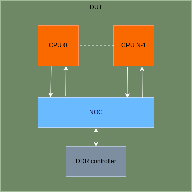
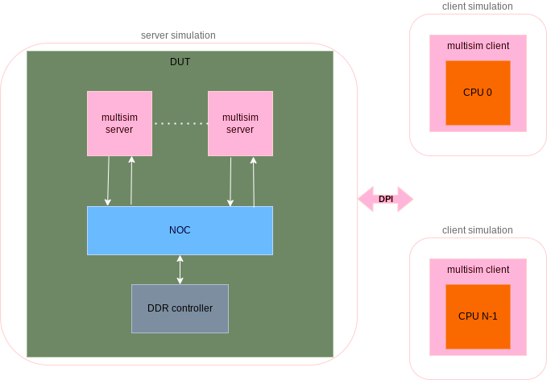

<div align="center">


simulate your RTL with real multi-threaded speed  
interface different simulators, chiplets and platforms together
</div>

# ✨ Rationale

`multisim` is a systemverilog/DPI library allowing multiple simulations/platforms to run in parallel and communicate to simulate your DUT.

Typically, you can have:
* 1 **server simulation** with your DUT skeleton (NOC, fabric, etc)
* N **client simulations** with 1 big instance each (computing core, chip, etc)

## example: normal vs multisim simulation
Assuming your original simulation has N CPUs that take a lot of simulation time.

You could transform this DUT:  


Into this one, running on N+1 simulation instances:  


# 🚄 Performance
Reusing [this example](./example/sim_server/sim_client/core/multi/src) where we have:
* 1 **server simulation** with 1 NOC
* `CPU number` **client simulations** with 1 `cpu` (slow module) each


# 📚 Usage

## examples
Tested platform combinations:

| client \ server | sim                                             | emu                                             | sw                                            |
| -               | -                                               | -                                               | -                                             |
| sim             | ✅ [examples](./example/sim_server/sim_client/) | ✅ [examples](./example/emu_server/sim_client/) | untested                                      |
| emu             | untested                                        | untested                                        | untested                                      |
| sw              | ✅ [examples](./example/sim_server/sw_client/)  | ✅ [examples](./example/emu_server/sw_client/)  | ✅ [examples](./example/sw_server/sw_client/) |

## available modules
* core library (ready/valid protocol)
    * `client->server`: [multisim_client_push](./src/core/multisim_client_push.sv) and [multisim_server_pull](./src/core/multisim_server_pull.sv)
    * `server->client`: [multisim_server_push](./src/core/multisim_server_push.sv) and [multisim_client_pull](./src/core/multisim_client_pull.sv)
* other protocols:
  * [axi](./src/axi/)
  * [apb](./src/apb/)
  * [quasi static signals](./src/quasi_static/) (useful for signals without control signals like IRQ)

## available platforms
* SIMULATION
    * tested with **Verilator 5.040** (`./run` in [sim_server examples](./example/sim_server/))
    * tested with **QuestaSim 2024.3** (`./run_questa` in the [sim_server examples](./example/sim_server/))
    * tested with **VCS X-2025.06** (`./run_vcs` in [sim_server examples](./example/sim_server/))
* EMULATION
    * define `MULTISIM_EMULATION` in SV and C/C++ compilation
    * tested with **Veloce v23.0.1** (`./compile` in [emu_server examples](./example/emu_server/))
    * ZeBu: define `MULTISIM_ZEBU` instead, see [ZeBu](#zebu)
        * tested with **ZeBu W-2025.06-4** (`./compile -e zebu` in [emu_server examples](./example/emu_server/))
* SW
    * define `MULTISIM_SW` in C/C++ compilation
    * [client API](src/core/multisim_client.h) / [server API](src/core/multisim_server.h)
    * tested with **GCC 15.2.1**

Look at those files to have more info about those platforms:
* [multisim_common.h](src/core/multisim_common.h)
* [multisim_common.svh](src/core/multisim_common.svh)

## channels
* **server simulation** and **client simulations** communicate through channels
* channels direction can be `client->server` or `server->client`
* each **simulation** can use multiple channels
* `multisim` modules need a unique `server_name` to link a client/server channel together
* client modules need to set `server_runtime_directory` to know the port/ip address of each channel

## ZeBu
Define `MULTISIM_ZEBU` (implies `MULTISIM_EMULATION`) in SV and C/C++ compilation: the server modules
keep the same code, [multisim_common.svh](./src/core/multisim_common.svh) adapts their DPI calls:
* the server modules are ZEMI3 transactors (ZeBu removes the DPIs with outputs from its other DPI
  flows), declare them in the zCui project: `xtors -add {multisim_server_pull ...} -type ZEMI3`
* pull/push are ZEMI3 deferred DPIs: the emulator clocks keep running for
  `MULTISIM_ZEBU_DPI_LATENCY` (default 16) cycles while the host processes the call
* `server_name` is a packed `bit [8*MULTISIM_SERVER_NAME_LEN-1:0]` (ZEMI3 has no `string` type):
  connect a string literal of at most `MULTISIM_SERVER_NAME_LEN` (default 32) characters
* the runtime loads `libdpi.so` and the transactor libraries with `zemi3 -lib`

The [emu_server examples](./example/emu_server/) share their ZeBu flow in
[example/emu_server/zebu](./example/emu_server/zebu/), with 2 environment variables for site settings:
* `MULTISIM_ZEBU_SETTINGS`: UTF file sourced by the zCui project (e.g. `grid_cmd`, `clock_config`)
* `MULTISIM_ZEBU_LAUNCHER`: command prefix of `zRci` to book an emulator
  (e.g. `srun --emu-work-dir ./zcui.work/zebu.work`)

```bash
cd example/emu_server/sw_client/core
./compile -e zebu
./output/run
# or all the examples
cd example/emu_server
./run_all.sh -e zebu
```

## 4-state support
By default, `multisim` uses 2-state logic (0 and 1).

However 4-state logic (0, 1, X and Z) can be used by using the parameter `DATA_IS_4STATE`.  
See the [axi_4state example](./example/sim_server/sim_client/axi_4state/multi)

4-state logic:
* is currently not supported in EMULATION
* doubles the amount of bytes exchanges over TCP/IP sockets

## compilation
1. source [env.sh](./env.sh)
2. pass the right files to your simulator:
* server simulation, see [example](./example/sim_server/sim_client/core/multi/run_cpu)
* client simulation, see [example](./example/sim_server/sim_client/core/multi/run_top)

### shared objects
If your platform requires a shared object (.so file), it can be compiled like so:
```bash
# SW client example
g++ -o multisim_sw_client.so -g -shared -fPIC \
  -DMULTISIM_SW                               \
  $MULTISIM_SRC/core/multisim_client.cpp      \
  $MULTISIM_SRC/core/socket_server/client.cpp
```

Look in the [example](./example) directory for more examples.

## end of simulation
You can either:
* use the helper function `$MULTISIM_SRC/bin/kill_all_clients` to kill clients running in the backgroud
* use an "exit" channel to send exit instructions to the clients/servers you want to kill
* write a custom kill script

Find more info about PIDs/IPs of your clients in the server runtime directory in `.multisim/client*.txt`

# ⚖️ Pros and Cons
Pros:
* speed: split your big DUT in as many smaller parts as you want
* interoperability: can use different simulators/platforms combinations (Verilator, VCS, Questa, Xcelium, Veloce, Palladium, Zebu, Qemu etc)
* scalability: as long as you have enough CPUs on your server

Cons:
* ⚠️ **no cycle accuracy** ⚠️: transactionally accurate, but not cycle accurate
* harder debug: waveforms split on N+1 simulation, no time coherency in between them

# 🚀 Future
* simple transaction logging to help debug
